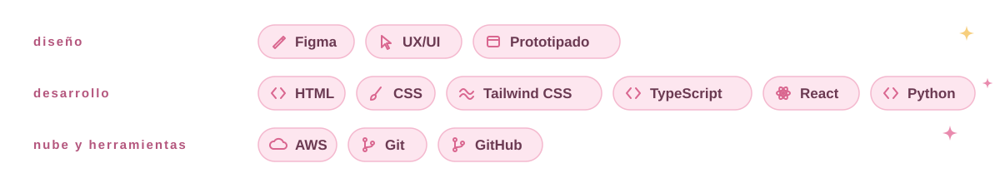

  

<table align="center">
  <tr>
    <td width="210" align="center">
      
    </td>
    <td>
      <h3>✦ sobre mí</h3>
      🎓 Estudiante de <b>Ingeniería de Sistemas</b> · <b>5.º semestre</b> 
      🏛️ <b>Universidad de la Costa (CUC)</b> · Barranquilla, Colombia 
      ✉️ <a href="mailto:nmiranda7@cuc.edu.co">nmiranda7@cuc.edu.co</a>  
      Me encanta el punto donde se encuentran el <b>diseño</b> y la <b>tecnología</b>. Me interesa especialmente el <b>UX/UI</b>:
      crear interfaces bonitas, claras y fáciles de usar, pensadas para quienes las usan.
      Hoy estoy aprendiendo a programar y a diseñar, un proyecto a la vez. ✦
    </td>
  </tr>
</table>

  

## ✦ lo que me gusta

  

## ✦ aprendiendo

  

## ✦ proyectos

| Proyecto | De qué se trata |
|---|---|
| **QR Care** · [qrcare.app](https://qrcare.app) | Plataforma SaaS en equipo para reportar daños en instalaciones y equipos escaneando un código QR (React + TypeScript, AWS Lambda, DynamoDB, Cognito y Amplify). Mi parte: el panel de control con indicadores, la tabla de reportes con filtros, el detalle del ticket, el flujo de estados y la documentación del CI/CD. |
| [**Salón de belleza**](https://github.com/nicolemiranda783-creator/salon-belleza-poo) | Proyecto final de Programación Orientada a Objetos, en Python. |
| [**Sistema de Gestión para Peluquería**](https://github.com/nicolemiranda783-creator/Sistema-de-Gesti-n-para-Peluquer-a) | Sistema de gestión para una peluquería. |

  

